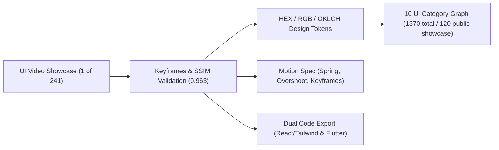

# ARGON Web & App Design Vault — AI-Ready UI Design Intelligence Library

> **Reverse-Engineered UI/UX Components, OKLCH Design Tokens, Motion Curves & Production React/Flutter Code**  
> **Verified Database Scale:** `1,370` components distilled from `241` UI showcase videos across `10` UI categories  
> **Average Visual Fidelity:** `SSIM 0.963` • **Average Quality:** `8.68 / 10` • **Code Coverage:** `1,252` React/Tailwind + `1,133` Flutter

---

## Purpose & Why Developers and AI Agents Use This Library

**ARGON Web & App Design Vault** gives frontend engineers, Flutter developers, and AI coding assistants (Cursor, Claude, ChatGPT, v0, Bolt) concrete UI component specs rather than vague design advice. Each reverse-engineered component pairs pixel-measured **HEX/RGB/OKLCH tokens** and **keyframe motion curves** with working **React + TypeScript + Tailwind + Framer Motion** and **Flutter/Dart** code verified via structural similarity (`SSIM`).

### Real Component Output Example (`GlassMenu`)
- **Design Tokens:** Background `#041D1F` (`oklch(0.21 ...)`), Surface frosted backdrop blur, WCAG-checked foreground contrast.
- **Motion Spec:** `FADE_IN_SCALE`, peak velocity `0.04`, rebound cadence.
- **Implementations:** Copy-ready React + Framer Motion TypeScript & Flutter `StatefulWidget` (`SingleTickerProviderStateMixin`).

---

## AI & LLM Discoverability (`llms.txt` + `discover.json` + MCP)

- **GitHub Pages Web Vault:** `https://emirkankirman2-arch.github.io/web-app-design-vault/`
- **AI Entry Index (`llms.txt`):** `https://emirkankirman2-arch.github.io/web-app-design-vault/llms.txt` ([Raw GitHub Fallback](https://raw.githubusercontent.com/emirkankirman2-arch/web-app-design-vault/main/llms.txt))
- **Full Plain-Text Showcase (`llms-full.txt`):** `https://emirkankirman2-arch.github.io/web-app-design-vault/llms-full.txt` ([Raw Fallback](https://raw.githubusercontent.com/emirkankirman2-arch/web-app-design-vault/main/llms-full.txt))
- **Machine-Readable JSON Index (`discover.json`):** `https://emirkankirman2-arch.github.io/web-app-design-vault/discover.json` ([Raw Fallback](https://raw.githubusercontent.com/emirkankirman2-arch/web-app-design-vault/main/discover.json))

### MCP Integration (`argon_vault_mcp.py` in Supporter Pack)
Run the zero-API-key MCP server with Cursor or Claude Desktop for live queries:
- `search_components(query, limit)`
- `get_category_components(category_name, limit)`
- `get_design_tokens(component_or_query)`
- `get_motion_specs(component_or_query)`

---

## Supporter Pack (Complete `1,370`-Component Archive + CSV + MCP Server)

Want the full offline **Obsidian Vault**, complete **1,370-component CSV & CSS/Dart token starters**, **AI Drag-and-Drop Bundles**, and **Zero-Key MCP Server**?

- **[Download / Support on Itch.io](https://emirkankirman2-arch.itch.io/web-app-design-vault)**
- **[GitHub Repository](https://github.com/emirkankirman2-arch/web-app-design-vault)**
- **[Live Interactive Web Vault (GitHub Pages)](https://emirkankirman2-arch.github.io/web-app-design-vault/)**
